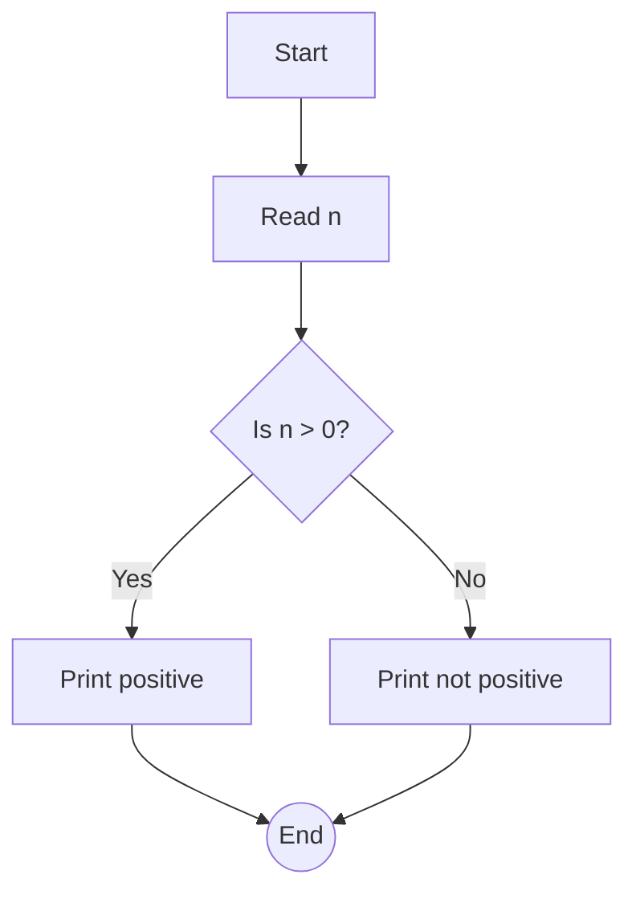
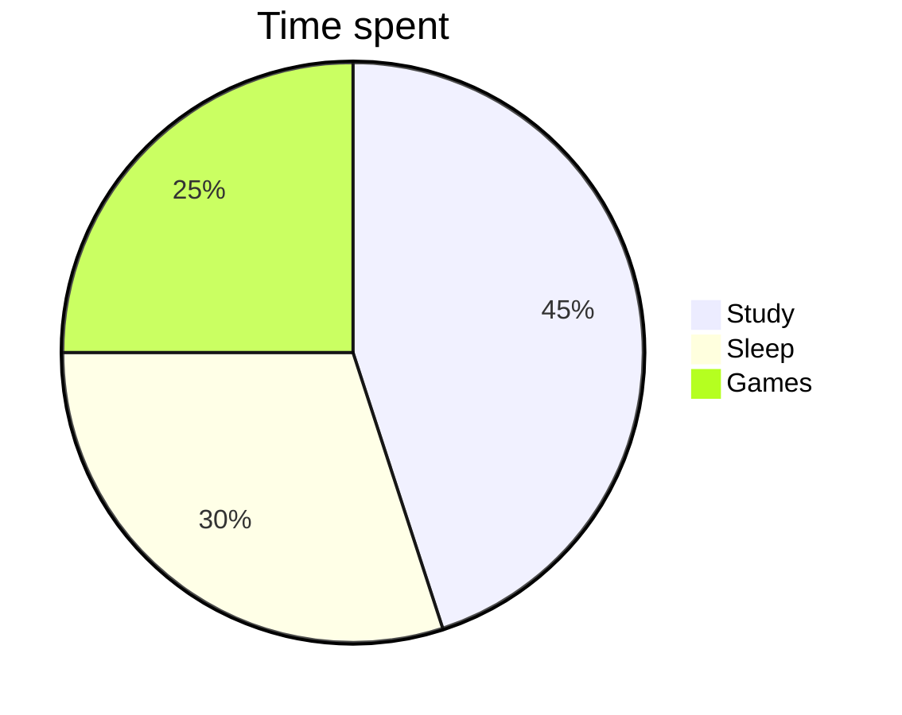

## [red]Graphs[/red], tables and diagrams

Sketch the graph of $y = x^2 - 2x - 3$ and mark the roots.

```graph
y = x^2 - 2x - 3
x: -3 .. 5
points: (-1, 0), (3, 0)
```

Compare [green]$\sin x$[/green] with [red]$\cos x$[/red] on $[0, 2\pi]$:

```plot
y = sin(x) [green]
y = cos(x) [red]
x from 0 to 2pi
```

The circle [color=#b0006a]$x^2 + y^2 = 4$[/color]:

```graph
x^2 + y^2 = 4
x: -3..3
```

### Results table

| Method | Time complexity | Notes |
|---|---|---|
| Bubble sort | $O(n^2)$ | Simple but slow for large inputs because it compares every pair |
| Merge sort | $O(n \log n)$ | Stable, needs extra memory |
| Quick sort | $O(n \log n)$ average | Fast in practice |

```bar
title: Marks scored
bar: Maths=82, Physics=74, Chemistry=91, English=65
```

### Flowchart



ASCII diagram from a GPT answer:

```
+---------+      +----------+
|  Input  | ---> | Process  |
+---------+      +----------+
                      |
                      v
                 +----------+
                 |  Output  |
                 +----------+
```



[blue]Final answer:[/blue] [red]$\boxed{x = -1 \text{ or } x = 3}$[/red]
